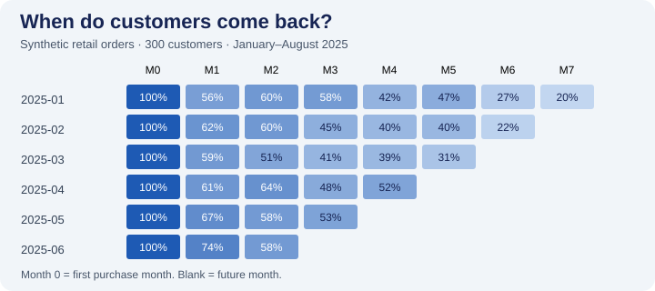

# SQL Cohort Retention Analytics

An analytics project that answers **when customers return after their first purchase**. A SQLite query builds monthly cohorts, counts distinct returning customers and fills observed months with zero activity.

The Streamlit dashboard provides a retention heatmap, a cohort drill-down and a CSV download. The synthetic fixture contains 300 purchasing customers with activity from January through August 2025.



The fixture has 1,931 completed orders and **63.3% weighted month-one retention**. See [the complete cohort results](cohort-results.csv).

## Metric contract

| Item | Definition |
| --- | --- |
| Cohort | Month of the customer's first completed purchase with positive amount |
| Monthly active customer | A cohort member with at least one qualifying purchase that month |
| Retention | Active customers in a given month divided by the original cohort size |
| Observation window | January–August 2025; August is fully observed |
| Month 0 | First-purchase month, always 100% |
| Missing future month | Has no output row and no heatmap cell |
| Observed month without a repeat purchase | Appears with 0% retention |

A customer can return after skipping a month. Retention can therefore rise between months. Multiple orders in one month count as one active customer. Cancelled orders do not establish a cohort or count as activity.

## Reproduce

From this folder, using Python 3.11 or newer:

```sh
python -m pip install -r requirements.txt
python -m unittest -v
python analysis.py
python -m streamlit run app.py
```

`analysis.py` generates `orders.csv` and `cohort-results.csv`. A fixed seed keeps the fixture reproducible. `cohort.sql` performs the cohort analysis using CTEs, distinct-customer counts and a recursive calendar.

## What the validation covers

A hand-calculated fixture checks repeat-order deduplication, a skipped month with 0% activity, return after a gap, and future months. Duplicate order IDs, dates beyond the observation window and invalid dates are rejected.

## Business use

Compare cohorts at the same maturity before choosing a segment for retention outreach. The dashboard can suggest where to investigate; a campaign's incremental effect would require a separate experiment. Results in this repository come from synthetic data.

## Resume bullet to adapt

Built SQL cohort retention analysis and a Streamlit dashboard for 300 synthetic customers, defining monthly activity metrics and validating customer counts, zero-activity months and observation windows.
